<picture>
  <source media="(prefers-color-scheme: dark)" srcset="assets/hero-dark.svg">
  
</picture>

 

 

I'm a software engineering student in Novi Sad. I like problems where a wrong answer costs real money or time, and I want every result traceable to where it came from. Right now that means **multi-agent AI systems you can audit**, **software for regulated, unglamorous industries**, and the **systems fundamentals** under both.

<table>
<tr>
<td width="33%" valign="top">

**🛠️ Building** 
[Ordoverse](https://ordoverse.com): software that brings order to the work a company depends on. First product: **BZR autopilot**, for occupational-safety agencies.

</td>
<td width="33%" valign="top">

**🤖 Exploring** 
Agent teams that check each other: parallel investigators, verifiers, and knowing when to say *no*. Most recently on [Mozaik](https://github.com/jigjoy-ai/mozaik).

</td>
<td width="33%" valign="top">

**📚 Studying** 
Storage engines, parallel computing, computer graphics and ML at FTN, Novi Sad.

</td>
</tr>
</table>

## ✦ Featured work

<table>
<tr>
<td width="50%" valign="top">

### [🛩️ blackbox](https://github.com/ljubogdan/blackbox)
**A flight recorder for purchases made by AI agents.** Parallel agent investigators stop a risky payment before it settles, and when a customer disputes one, they work out who was at fault and split the liability. Every figure traces back to a sealed record.

`TypeScript` `Mozaik` `Claude` `Stripe test mode` 
JigJoy Black Friday AI Hackathon · Agents in Finance

</td>
<td width="50%" valign="top">

### [🤝 prenup](https://github.com/ljubogdan/prenup)
**Research partnerships, agreed up front.** Agents pair researchers with companies, negotiate IP and publication terms before anyone meets, check every fact against the data, and decline when there's no good match.

`TypeScript` `Mozaik` `Node 22` `59 tests` 
NTP Novi Sad × JigJoy Hackathon · EINSTEIN track · [▶ live board](https://prenup-board.onrender.com)

</td>
</tr>
<tr>
<td width="50%" valign="top">

### [🧹 unfluff](https://github.com/ljubogdan/unfluff)
**See how much of your LinkedIn feed is noise, then hide it.** A browser extension that measures ads, suggested posts and engagement bait, then collapses, removes or labels them. No network requests, no tracking.

`JavaScript` `Chrome extension` `Manifest V3`

</td>
<td width="50%" valign="top">

### [🔎 ai-diff-review-service](https://github.com/ljubogdan/ai-diff-review-service)
**Async AI code review for unified diffs.** A FastAPI service with job polling, replayable SSE streams, idempotency, caching and rate limiting. Ships a deterministic mock scorer and a Gemini provider that fails cleanly.

`Python` `FastAPI` `SSE` `Gemini` `Railway`

</td>
</tr>
<tr>
<td width="50%" valign="top">

### [☁️ cloud-social-analytics](https://github.com/ljubogdan/cloud-social-analytics)
**Serverless social-data lakehouse on AWS.** Pulls Twitter and Hacker News data through bronze, silver and gold layers with Lambda, then serves Superset dashboards and Discord alerts.

`Python` `AWS CDK` `Lambda` `Superset`

</td>
<td width="50%" valign="top">

### [🗄️ NASP-NoSQL-Engine](https://github.com/ljubogdan/NASP-NoSQL-Engine)
**A key-value storage engine from scratch.** WAL, memtable, SSTables with Bloom filters and Merkle trees, an LRU cache, prefix and range scans, and token-bucket rate limiting.

`Go` `LSM tree` `Bloom filter` `Merkle tree`

</td>
</tr>
</table>

## 🔒 Private repositories

These repos are **private**. Some contain client or course material I can't publish, and some are products in progress. **If you'd like access** (for hiring, a collaboration, or just to read the code), message me on [LinkedIn](https://www.linkedin.com/in/ljubogdan/) or [X](https://x.com/ljubogdan) with your GitHub username and which repo you want to see.

| | Project | What it is | Stack |
|:-:|---|---|---|
| 🔒 | **bzr-autopilot** | Web app for Serbian occupational-safety (BZR) agencies: tracks every client's training, medical exams and inspections, emails reminders before deadlines, imports and exports Excel, and drafts risk-assessment acts with AI. *Ordoverse product, in active development.* | Next.js · Supabase · Postgres RLS · Vercel · Claude |
| 🔒 | **ordoverse webpage** | Landing site for [ordoverse.com](https://ordoverse.com), with product pages and i18n. | HTML · CSS · JS · Cloudflare Workers |
| 🔒 | **rg-aquarium** | A 2D aquarium in modern OpenGL: fish, a crab, bubbles, food and a treasure chest, with custom shaders, textures and cursor. | C++17 · OpenGL 3.3 · GLFW · GLEW |
| 🔒 | **parallel-web-scraper-tbb** | A four-stage parallel pipeline (fetch → parse → analyze → store) that crawls and analyzes a book catalog, with retries and auto-discovery. | C++20 · Intel TBB · libcurl · CMake |
| 🔒 | **genetic-timetable-scheduler** | A genetic algorithm that schedules 60+ lectures and labs across 5 rooms and a full week under hard and soft constraints. | Python · NumPy |
| 🔒 | **checkers-python** | Checkers with a Minimax + alpha-beta AI, a SQLite transposition table, forced captures and time-aware search depth. | Python · Pygame · SQLite |
| 🔒 | **OOP2-Minotaur** | A console maze game with procedural labyrinths, a chasing Minotaur, fog of war and items with special effects. | C++17 |
| 🔒 | **solar-cycle-lstm** | Predicts solar cycles and storm risk from sunspot time series with an LSTM and Huber loss. | Python · TensorFlow · Keras |
| 🔒 | **tweet-emotion-classifier** | An RNN that sorts tweets into emotion classes. | Python · TensorFlow |
| 🔒 | **medinsurance-ann-tensorflow** | Predicts insurance premiums with linear regression vs. a neural network, plus EDA and feature engineering. | Python · TensorFlow · scikit-learn |

## ⚙️ Toolbox

   
  

  Also: Claude & Gemini APIs · Mozaik · Intel TBB · AWS CDK · Playwright · Vitest · pytest

---

Have something worth building? <a href="https://www.linkedin.com/in/ljubogdan/">Let's talk.</a>

